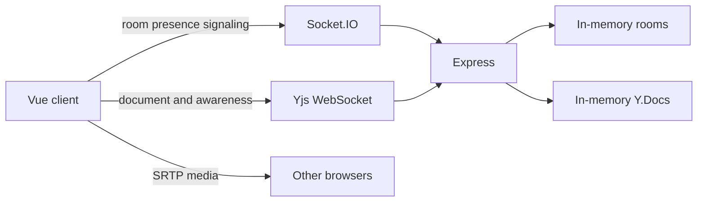
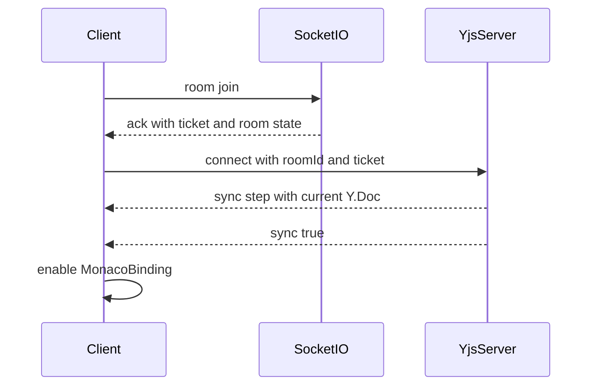
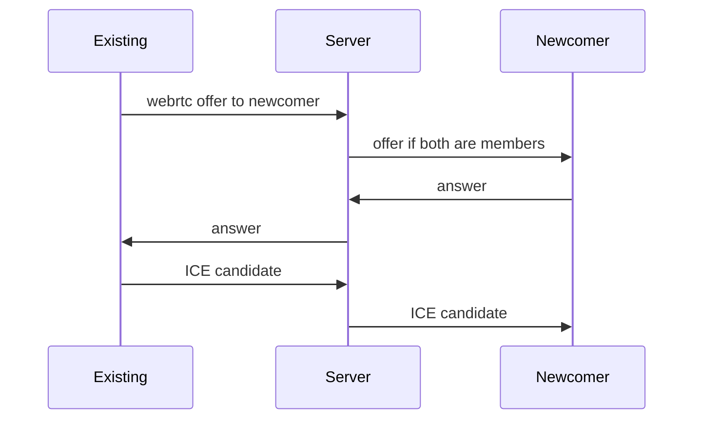

# CodeTogether

Code together. Think together.

CodeTogether is a browser workspace for small groups. People join a room with a display name, edit shared Monaco files at the same time, and can talk over a peer-to-peer audio and video mesh. There are no accounts. The source code lives only in the active room.

## Why these pieces

- **Socket.IO** carries room membership, presence, and WebRTC signaling. It is not the media path and it is not the document path.
- **Yjs** is the CRDT that merges concurrent edits. Late joiners receive the current document through the sync protocol. Presence and cursors travel as awareness updates, which do not rewrite the document.
- **y-websocket** is the maintained Yjs client for Yjs v13. The server speaks the same protocol on `/yjs` and owns the in-memory documents so a room can be destroyed on expiry. `y-socket.io` was not used: its last release is from 2023 and it has a known desynchronization bug.
- **Monaco** is the editor. **y-monaco** binds a `Y.Text` to the model and draws remote cursors.
- **WebRTC** carries audio and video with `RTCPeerConnection`. Socket.IO only exchanges offers, answers, and ICE candidates.

The editor stays read-only until the Yjs provider emits `sync` with `true`. A timer is not used as a stand-in for that event.

## Architecture



One Node process hosts Express, Socket.IO, and the Yjs WebSocket server. Socket.IO is created with `destroyUpgrade: false` so the `/yjs` upgrade is not destroyed. Room state and documents are process-local. A second instance would need a Socket.IO adapter and a shared Yjs store. Those are not part of this release.

### Collaborative editing



The first file is a `Y.Text` named `code`. Extra files are further `Y.Text` values named from the shared `files` map. `meta` stores the language of the first file. The invitation URL contains only the room id. A lock word, when one is set, is not part of that URL. The Yjs ticket is issued by the join acknowledgement and is kept in memory.

### WebRTC signaling

People already in the room offer to a new participant. The newcomer answers. Signals are unicast to the target socket after the server checks that both people are in the same room. A reconnect closes the old peer connection before a new offer is created.



Media is peer to peer. A configured TURN server relays encrypted packets and does not record them. Without TURN, calls between some networks fail. Same-machine and simple-NAT calls can succeed with the public STUN server alone.

## Local setup

Requirements: Node.js 20 or newer.

```bash
corepack enable
corepack prepare pnpm@10.15.0 --activate
pnpm install
pnpm dev
```

The web app is at `http://127.0.0.1:5173`. The API and both WebSocket endpoints are at `http://127.0.0.1:3001`.

Copy `.env.example` if you want to change limits or add TURN credentials. Local development works without an env file. Do not put TURN secrets in `VITE_*` variables. The browser receives ICE servers from the join acknowledgement.

## Scripts

- `pnpm dev` runs the web app and the server.
- `pnpm test` runs unit and integration tests.
- `pnpm --filter @codetogether/web e2e` runs the Playwright browser tests. Install the browser first with `pnpm --filter @codetogether/web exec playwright install chromium`.
- `pnpm typecheck` runs the TypeScript checks.

## Testing

Unit tests cover room ids, the room lifecycle with an injected clock, payload schemas, filenames, and the rate limiter.

Integration tests create rooms over Socket.IO, reject invalid and full rooms, resume after a disconnect, rate limit creates, reject signaling from non-members, reject a Yjs connection without a ticket, and check that two Yjs clients converge.

Playwright covers landing validation, keyboard focus, two-browser editing, caret names, download of the open tab, a lock word, chat, adding and closing a file, opening a text file, a shared run, terminal input and resize, a call column that fills the right side, and the narrow layout.

### Manual WebRTC checks

Automated tests do not prove that video works across networks.

- Two browsers on one machine.
- Two devices on one network.
- Two devices on different networks, with and without TURN.
- Camera and microphone denied.
- No camera available.
- A short network interruption.
- Leave the page and confirm the tab is no longer capturing the camera.

## Deployment

The API is a free Render web service built from the `Dockerfile`, so the image has Node 20 and Python 3. `render.yaml` selects the free plan and checks `/health`. The process listens on `0.0.0.0` and Render's `PORT`. A free service sleeps after 15 minutes with no visitors or open connections, takes about a minute to wake, and a sleep or restart clears every room because documents stay in memory.

The site is a static Vite build. On Vercel, set the project root to `apps/web` and set these before the first production build:

- `VITE_SERVER_URL` to the Render `https` origin.
- `VITE_YJS_URL` to the same host as `wss://.../yjs`.

Then set Render's `CLIENT_ORIGIN` to the exact Vercel origin and redeploy. Production CORS allows that origin only. HTTPS is required so browsers will permit `getUserMedia` outside localhost. Video across two networks still needs your own TURN credentials.

## Limits and privacy

- Four participants per room.
- Rooms last four hours after the last edit, with a twelve-hour hard cap.
- A disconnected participant can resume for 20 seconds.
- An empty room is removed after two minutes, and its document is destroyed.
- Documents are capped around 512 KB. Signaling payloads are capped at 64 KB.
- Room creation is rate limited per address. Signaling is rate limited per socket.
- No accounts, no database, and no copy of the source code after the room ends.
- Logs do not include document text, SDP, or ICE credentials.
- The app does not record calls.

Downloading code reads the current editor text and saves it under the open tab's name. Download all packs those tab names into a zip. Neither depends on a database.

## What is included

- Landing page, create, join by code, and join by link.
- Display names, pre-join device check, and join with devices off.
- Shared Monaco files, one model per file, shared language per file, local font size, dark and light theme.
- Remote cursors in distinct colors, a jump from the name on a video tile, line notes, reconnect, and resync.
- Copy, download under the open tab's name, download all as a zip, and formatting where Monaco provides a formatter.
- Open or drop a text file to add a shared file. A known extension sets the language. Added files can be closed. The first file stays.
- Room chat, opened from a message icon, and an optional lock word. Both disappear with the room.
- Run for JavaScript, Python, and TypeScript when Node can strip types. Output is shown in a shared terminal. The program runs on the server machine. It is not a sandbox.
- Ctrl+Enter to run, clear output, copy output, and input recall.
- Mesh audio and video for up to four people, with mute, camera, screen share, and leave. Turning the camera on during a call is sent to the other people. A short chime plays when someone joins.
- Focus states, reduced motion, and a compact layout for smaller screens.

## What is not included

Saved documents after the room ends, read-only roles, an SFU, and multi-server scaling. JavaScript, TypeScript, and Python run in the API process with an output limit, not in a sandbox. A run stays up until the program exits or someone stops it. More than four callers, or reliable cross-network media at larger sizes, needs an SFU such as LiveKit or mediasoup.

## Manual demo checklist

- Create a room from the landing page and confirm the pre-join screen appears before the editor.
- Copy the invitation link into a second browser profile, join with another name, and type in both editors.
- Confirm both documents show the same text and a remote cursor.
- Download the open file and confirm the saved name is that tab's name, such as `main.js`.
- Mute, turn the camera on after the call has started, and confirm the other browser shows the picture. Turn the camera off and leave the call. Leave the room and confirm the camera indicator in the browser goes away.
- Refresh one browser and confirm the document is restored with camera and microphone off.
- Try a call across two networks only after TURN is configured. Otherwise treat cross-network video as unsupported.
